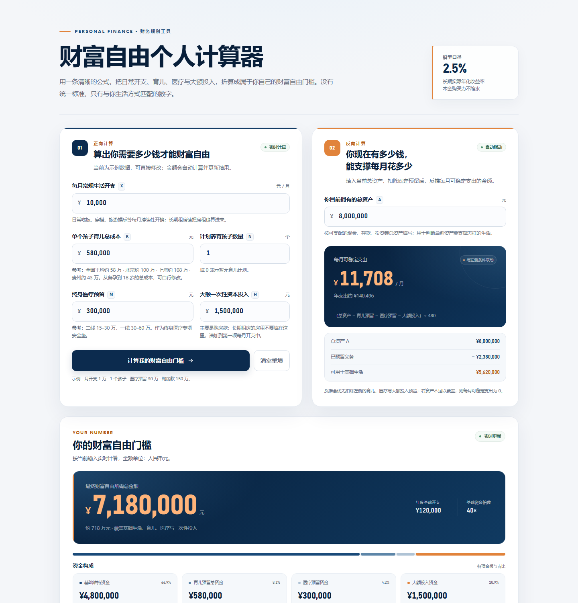

# 财富自由个人计算器

> 网上财富自由的数字五花八门。这个计算器用固定公式，按照你自己的生活标准，算出属于你的财富自由门槛。

**[在线体验](https://luzexxi.github.io/wealth-freedom-calculator/)** · [计算逻辑](#计算逻辑) · [本地运行](#本地运行) · [MIT License](LICENSE)

<p align="center">
  <a href="https://luzexxi.github.io/wealth-freedom-calculator/">
    
  </a>
</p>

## 项目简介

这是一个纯前端的财富自由计算器。输入每月生活开支、育儿成本、医疗预留和大额一次性投入，即可计算个人财富自由所需的总资金；也可以输入当前总资产，反向推演每月能够稳定支出的金额。

整个应用只有 **一个 HTML 文件**，CSS 与 JavaScript 全部内联，不依赖 Vue、React 或任何第三方库，不需要后端，也不需要构建。下载后双击即可使用。

页面默认带有一组示例数据，方便直接预览效果；点击「清空重填」即可输入自己的情况。

## 功能特性

- **正向计算**：根据生活开支、育儿、医疗与大额投入，计算财富自由所需总资金。
- **反向推演**：输入当前总资产，扣除既定预留后，反推每月可稳定支出。
- **实时更新**：修改输入内容时自动重算，也可以点击按钮计算并定位到结果区。
- **输入校验**：非数字、负数、无效孩子数量等会显示页面内提示，不使用弹窗。
- **千分位格式化**：输入与计算结果自动格式化为 `4,800,000` 这样的易读形式。
- **清晰的结果拆分**：展示基础维持资金、育儿预留、医疗预留、大额投入及各自占比。
- **响应式布局**：桌面端双卡片并排，平板和手机端自动堆叠。
- **完全本地运行**：无网络请求、无数据上传、无广告、无理财推广。

## 计算逻辑

### 财富自由总资金

```text
财富自由总资金 = 480 × 每月常规生活开支 X
              + 单个孩子育儿成本 K × 孩子数量 N
              + 终身医疗预留 M
              + 大额一次性资本投入 H
```

其中：

```text
480 = 12 ÷ 2.5%
```

一年有 12 个月，按 2.5% 的长期实际年化收益率反推，覆盖年度开支所需本金为 480 倍月开支。也就是说，基础生活资金大约相当于 40 年的年度开支。

### 反向计算

```text
每月可稳定支出 = (当前总资产 A - K × N - M - H) ÷ 480
```

反向计算会优先扣除育儿、医疗与大额投入预留；如果资产不足以覆盖这些预留，每月可稳定支出显示为 0。

### 输入参数

| 参数 | 含义 | 参考提示 |
| --- | --- | --- |
| X | 每月常规生活开支 | 包含吃饭、穿搭、旅游娱乐等持续性开销；长期租房的房租计入此项 |
| K | 单个孩子从备孕到 18 岁的育儿总成本 | 全国平均约 58 万，北京约 100 万，上海约 108 万，贵州约 43 万 |
| N | 计划养育孩子数量 | 可填 0 表示暂无育儿计划 |
| M | 终身医疗预留资金 | 二线约 15–30 万，一线约 30–60 万 |
| H | 大额一次性资本投入 | 主要是购房款；长期房租不要填在这里，应计入每月开支 X |
| A | 当前拥有的总资产 | 用于反向计算每月可稳定支出 |

## 前提假设

- 长期实际年化收益率为 **2.5%**，资产靠投资产生收益抵消通胀，本金购买力永久不缩水。
- 目标是资产购买力永久不下降，本金不会慢慢消耗。
- 如果全部存银行定期，无法达成该收益，需要做合理的资产配置。
- 如果接受本金逐年消耗，每月可以花更多钱；本计算器不包含这种情景。
- 育儿成本为从备孕到 18 岁的总投入，医疗预留为终身专项安全垫。
- 不计税费、手续费与重大意外，金额均为当前购买力口径。

> 这是「本金不消耗」的严格口径：每年只使用投资收益，不动用本金。

## 本地运行

无需安装依赖，也无需启动服务：

1. 下载或克隆本仓库。
2. 双击打开 `index.html`，即可在浏览器中使用。

```bash
git clone https://github.com/Luzexxi/wealth-freedom-calculator.git
cd wealth-freedom-calculator
```

如果系统默认程序没有关联浏览器，也可以右键 `index.html`，选择用 Chrome、Edge、Firefox 或 Safari 打开。

## 项目结构

```text
.
├── index.html      # 完整应用：HTML + CSS + JavaScript
├── README.md
├── LICENSE
└── docs/
    └── preview.png # README 界面预览
```

`index.html` 是完整且独立的计算器，可以单独复制、分发或部署到任意静态托管服务。

## 技术栈

- HTML5
- CSS3（原生变量、Grid、Flexbox、媒体查询）
- Vanilla JavaScript（无框架、无构建工具）
- `Intl.NumberFormat` 数字格式化

面向现代浏览器，桌面端与移动端均可使用。

## 贡献

欢迎提交 Issue 或 Pull Request。

- 报告问题时，请说明浏览器版本、复现步骤和预期结果。
- 提交功能改动时，请尽量保持「单文件、零依赖、纯前端」的项目特性。
- 涉及交互或界面的大改动，建议先开 Issue 讨论。

## License

本项目基于 [MIT License](LICENSE) 开源。

## 免责声明

本工具仅作为人生规划与财务思路推演工具，不构成任何理财或投资建议。计算结果依赖用户输入与固定假设，不代表未来实际收益，也不考虑税费、政策变化、重大意外等现实因素。请根据自身情况独立判断。
